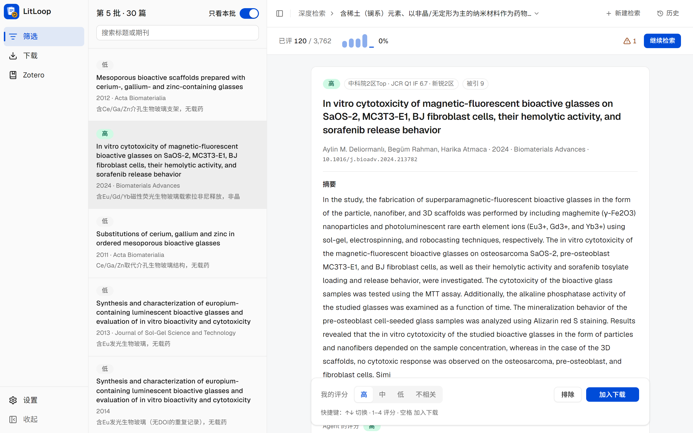
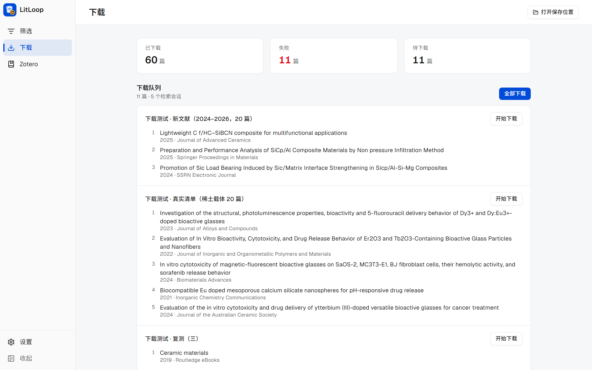
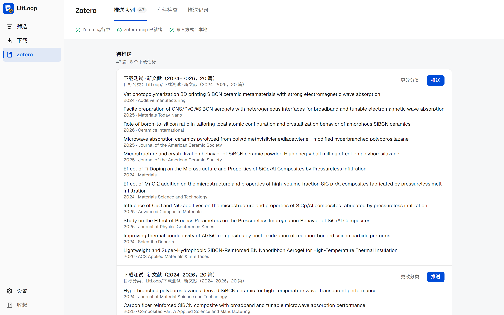
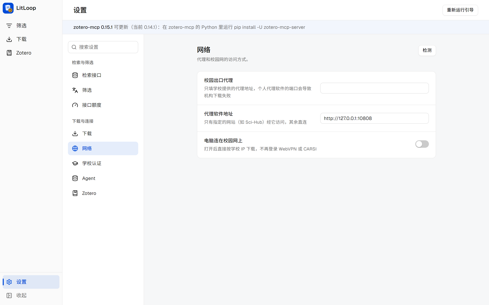

<div align="center">
  
  <h1>LitLoop</h1>
  <p><strong>文献检索、筛选、下载、归档的桌面 app</strong> · Agent 在后台检索和评分，你在 app 里做决定</p>

  <a href="./LICENSE"></a>
  <a href="https://modelcontextprotocol.io"></a>
  
  

  [截图](#截图) · [为什么用它](#为什么用它) · [一次完整的流程](#一次完整的流程) · [app 的四个页面](#app-的四个页面) · [深度检索](#深度检索怎么查全) · [下载](#下载怎么拿到全文) · [安装与启动](#安装与启动) · [搭配 Agent 使用](#搭配-agent-使用) · [项目状态](#项目状态)
</div>

> **项目还在开发中。** 检索、筛选、下载、存进 Zotero 这条流程已经能用，并在真实课题和测试集上验收过；桌面 app 的筛选、下载、Zotero、设置已经能用，但还没有安装包，需要从源码运行。系统综述和分析归纳还没做。详见[项目状态](#项目状态)。
>
> LitLoop 是 [Rimagination/scansci-pdf](https://github.com/Rimagination/scansci-pdf)（Apache-2.0）的独立衍生项目，由 [dysprosium231](https://github.com/dysprosium231) 维护，与原作者无隶属关系。下载和机构通道的大部分能力来自原项目，LitLoop 的改动见 [NOTICE](NOTICE)。

## 截图

| 筛选：Agent 的评分和理由，你来拍板 | 下载：待下载队列，逐篇显示进度 |
|:---:|:---:|
|  |  |
| **Zotero：按下载批次推送到分类** | **设置：每组设置都能检测** |
|  |  |

## 为什么用它

做一个课题的文献调研，通常卡在四个地方。LitLoop 分别这样处理：

| 卡在哪里 | LitLoop 怎么做 |
|---|---|
| **检索结果又多又杂**，前几页一半离题 | 去重、去掉离题标题和垃圾记录，预印本并入正式版；每条带清洗过的完整摘要、真实被引数，标出撤稿和关注声明 |
| **读不过来**，几百篇摘要不知道先看哪篇 | Agent 读摘要，逐篇评为高 / 中 / 低 / 不相关并写一句理由；深度检索按你的评分持续重新排序，最可能相关的排在前面 |
| **下载难**，开放获取、出版商、学校 WebVPN、CARSI 一个个试 | 一次点击：先拿开放获取，再试出版商官网，最后逐个走学校通道；需要你登录或过人机验证时，app 会提醒并等你 |
| **整理费事**，一篇篇拖进 Zotero、改文件名 | 按 `作者年份_标题_DOI.pdf` 命名，按下载批次推送到 Zotero 分类，库里已有的复用，并检查附件是否为空 |

几条原则：

- **你拍板。** Agent 只给评分和理由，选哪篇、下哪篇由你决定；你改过的评分覆盖 Agent 的。
- **登录在你自己的浏览器里完成。** 学校账号、密码、人机验证都由你操作，LitLoop 不保存密码，也不绕过验证。
- **数据都在本机。** 筛选记录、下载记录、PDF 都在 `~/.litloop/` 和你选的文件夹里；Zotero 走本机写入。
- **用多少接口额度看得见。** 各接口的官方限额集中写在 [docs/API_LIMITS.md](docs/API_LIMITS.md)，app 的设置页显示今天的用量。

## 一次完整的流程

以“稀土掺杂的非晶纳米材料作药物载体”为例：

1. **提出问题。** 在 app 的「筛选」页点「新建检索」填写问题和纳入标准，或者直接对 Agent（Claude Code、Codex 等）说：“把稀土掺杂非晶纳米载体做药物递送的文献尽量查全，分批给我筛”。
2. **Agent 检索和评分。** 快速检索几秒出结果；深度检索先建候选池（几千篇），每批推给你 30 篇，Agent 先评一遍。
3. **你在 app 里筛。** 左边是本批列表，右边是摘要（可译成中文）、期刊分区、被引数和 Agent 的理由。键盘上 `↑`/`↓` 换篇、`1`–`4` 评分、`空格` 加入下载。评完点「继续检索」生成下一批，不用回到对话。
4. **下载。** 「下载」页汇总了各次检索里选中、还没下到的文章，点「全部下载」。每篇显示它正在做什么、最后从哪里下到；需要你登录学校账号或点人机验证时，页面顶部出现琥珀色提示。
5. **进 Zotero。** 「Zotero」页按下载批次列出待推送的文献，选好分类点「推送」。
6. **回看。** 「筛选」页右上角的「历史」按课题列出每次检索读了多少、选了哪些，最终清单可以导出 BibTeX / RIS / DOI 列表。

## app 的四个页面

### 筛选

- **本批列表**：标题、期刊、年份、Agent 的评分和一句理由；可只看本批，或搜索标题和期刊。
- **详情**：完整摘要、期刊分区（中科院、JCR，需配套插件）、被引数、DOI；摘要可自动译成中文。
- **翻译**：在「设置 → 筛选」选范围（评为高、高和中、全部或不自动翻译）和服务。DeepSeek、DeepL 用你自己的 Key，由 app 在打开文献时翻译并保存译文，不耗对话额度；选 Agent 则在评分时顺带翻译。
- **继续检索**：Agent 停下后，按目前全部评分生成下一批；这一批你先评，回到对话后 Agent 会补上它的评分。
- **深度检索进度**：顶部显示已评篇数 / 候选池大小、每批高相关比例的小柱图、各阶段进度和预计剩余时间；到了建议停止的时候会提示。
- **历史**：按课题分组，每次检索读了多少、选了哪些；可导出或一键加入下载。

### 下载

- **待下载**：跨检索汇总、去重、编号；可以按检索分别开始，也可以全部下载。
- **每篇的状态**：正在做什么（如“正在打开 Elsevier 的页面”“正在走学校通道：WebVPN 浏览器”）、最后的来源和文件；失败时写明原因和下一步（如“学校没有订阅：已用学校身份登录出版商网站，仍没有全文”）。
- **需要你时**：登录学校账号、通过人机验证时页面顶部出现琥珀色提示，程序会一直等你；不想等的那篇点「跳过」，整个任务可以「取消」。
- **结果**：打开 PDF、打开所在文件夹、重试没下到的。

### Zotero

- 显示 Zotero、zotero-mcp 是否就绪和写入方式；不是本地写入时可一键授权（本地写入几秒一篇）。
- **推送队列**：按下载批次列出已下载、还没进 Zotero 的文献，选分类后推送，不存在的分类自动新建。
- **附件检查**：找出某个分类里缺失或为空的 PDF 附件，确认后用本机的 PDF 重新附加，或加入下载。
- **推送记录**：逐篇回看结果（新建、库里已有、PDF 没附上、失败）。

### 设置

- 检索接口 Key、筛选与翻译、接口额度、下载、网络、学校认证、Agent、Zotero，每组都有「检测」按钮。
- **接口额度**：各接口今天的用量和官方限额。
- **网络**：识别 v2rayN、Clash 等代理软件是否开了 TUN 模式，并给出直连规则的设置步骤；“电脑连在校园网上”打开后直接按学校 IP 下载。
- **首次引导**：第一次打开时逐步填写检索接口、翻译、下载、网络、学校认证、Zotero，每步可检测、可跳过，之后可在设置页重新运行。
- 浅色和深色主题跟随系统；左侧导航可收起只留图标。

## 深度检索：怎么查全

要把一个课题查全时用深度检索。Agent 给出问题、4–8 组英文检索词、核心词和几篇种子文章；你在 Zotero 里已经有这个课题的分类时，也可以把整个分类当种子。

1. **建候选池**：每组检索词各取 100 条，再加上和种子共同引用较多、且标题或摘要含核心词的文章。核心词可以写几条，每条都必须出现；同一概念的不同写法用 `|` 连起来，如 `Al|aluminum|aluminium`。
2. **分批筛选**：每批 30 篇。第一批按“共同引用 + 检索词匹配”排序；之后由一个轻量模型按你和 Agent 的全部评分重新排序（系统综述筛选常用的持续主动学习）。
3. **滚雪球**：评为“高”的文章自动成为新种子，再往外扩展；你给的种子权重最高，避免越滚越偏。
4. **补摘要**：缺摘要的候选同时问 Semantic Scholar、Scopus、Crossref，先答先用，没有摘要的文章也不会被埋没。
5. **建议停止**：最近一批的高相关比例降到最好一批的 1/6 以下，或已筛满 200 篇时提示停止，并估计还剩多少相关文章没读到。

**验收结果**（测试集和判断标准在 `tests/acceptance/`，可用 `scripts/eval_deep_search.py` 重放）：

| 测试集 | 读了多少篇 | 找到目标 |
|---|---|---|
| SiC/Al 无压浸渗 | 150 | 19 篇中的 17 篇 |
| PDC 陶瓷气凝胶 | 120 | 26 篇中的 24 篇 |
| 稀土药物载体 | 150 | 9 篇中的 2 篇（分支多、彼此少引用，还在改进） |

详细的参数和额度控制见 [docs/AGENT.md](docs/AGENT.md#检索与筛选)。

## 下载：怎么拿到全文

点「全部下载」后，30 篇以内的清单按下面的顺序走（更大的清单走批量车道）：

```
① 开放获取     开放获取直链、MDPI / SciOpen 等按 DOI 拼出的地址，几篇同时下
② Sci-Hub      仅在你开启时；2024 年及以后发表的跳过（基本没收录）；线路设为“谁快用谁”时先测速
③ 逐篇下载     免费来源和出版商官网同时尝试 → 没拿到再逐个走学校通道
               学校通道：WebVPN 直接下载 → WebVPN 浏览器 → CARSI → EZProxy
```

- **出版商官网**：Elsevier、Wiley、Springer、ACS、RSC、T&F、SAGE、IOP、IEEE 等约 30 家有专门的处理，其余用通用的官网浏览器。学校 IP 有权限时，官网这一步就能下到，不用登录。
- **学校通道**：支持 100 多所高校的 WebVPN、CARSI 联邦认证、EZProxy。一次只开一个窗口等你登录；每一步最多 4 分钟（你正在登录时自动顺延），卡住就进入下一条。
- **不做无用功**：用学校身份登录出版商网站后仍没有全文的，判定为学校没订，不再走学校通道；Sci-Hub 说没收录的，一小时内不再问。
- **文件**：按 `作者年份_标题前几个词_DOI.pdf` 命名，文件名和论文一一对应；下载前会核对 PDF 是不是这篇论文。
- **记录**：日志里每一段都有耗时（`[timing]`），慢在哪一步一看便知。

实测（2026-10-18，一份 2024–2026 年的新文献清单，14 篇，不在校园网，经 WebVPN/CARSI）：11 篇成功；Elsevier、T&F、ACS 的官网一般 20–70 秒一篇，开放获取 10–25 秒。失败的 3 篇里，一篇是学校没订的会议论文集章节，一篇是 SSRN 预印本。

各出版商和机构通道的配置、代理设置和故障排查见 [docs/DOWNLOAD.md](docs/DOWNLOAD.md)。Sci-Hub、LibGen 默认关闭，是否使用由你决定；使用机构通道时请遵守学校和出版商的使用条款。

## 安装与启动

桌面 app 目前只能从源码运行，还没有安装包。需要：Python 3.11+、Git、Node.js、Rust（Windows 上用 MSVC 工具链）。

1. **装 Python 后台。** 最省事的办法是对 Claude Code、Codex 或 ZCode 里的 Agent 说：

   ```text
   帮我安装或更新这个插件：https://github.com/dysprosium231/litloop-paper-agent
   ```

   Agent 会拉取代码、建独立的虚拟环境、安装依赖并注册 MCP。手动安装的步骤见 [docs/AGENT.md](docs/AGENT.md#安装与配置详情)。

2. **启动 app。** 在仓库的 `app` 目录：

   ```bash
   npm install
   npm run tauri dev
   ```

   第一次编译 Rust 需要几分钟，之后约半分钟出窗口。环境变量 `LITLOOP_PYTHON` 可指向装了 LitLoop 的 Python。开发说明和重启脚本见 [app/README.md](app/README.md)。

3. **走一遍首次引导。** 至少填 OpenAlex Key 和联系邮箱；要下订阅论文就在「学校认证」里选学校。

### 依赖与 Key

| 组件 | 必需吗 | 用来做什么 | 没有时 | 怎么获取 |
|---|---|---|---|---|
| Python 3.11+、Git | 必需 | 运行和更新 LitLoop | 无法运行 | Windows：`winget install Python.Python.3.12 Git.Git` |
| OpenAlex API Key | **强烈推荐** | 快速检索和深度检索的主要数据源 | 每天约 1000 积分，一次深度检索就可能用完 | [openalex.org](https://openalex.org) 免费申请；填进设置或环境变量 `OPENALEX_API_KEY` |
| Elsevier API Key | **强烈推荐** | 从 Scopus 补摘要；有全文权限时下载 ScienceDirect 全文 | Elsevier 文章常缺摘要，深度检索只能按标题排序 | [dev.elsevier.com](https://dev.elsevier.com) 免费申请；环境变量 `ELSEVIER_API_KEY` |
| Springer Nature Meta API Key | 推荐 | 补 Springer、Nature、BMC 文章的摘要 | 只能靠 Scopus 和 Crossref，缺得多一些 | [dev.springernature.com](https://dev.springernature.com)；环境变量 `SPRINGER_META_API_KEY` |
| 联系邮箱 | 推荐 | 发给 Crossref、OpenAlex、Unpaywall，便于联络和提额 | Crossref 按公共池限速 | 填进设置 |
| scansci-find（发现引擎） | 推荐 | 快速检索和深度检索的关键词路线 | 自动退回内置检索，较慢 | 安装时加 `--with-find` |
| Zotero 7+、zotero-mcp | 可选 | 把文献和 PDF 写进本机 Zotero | 只能下载到文件夹 | 在 app 的 Zotero 页授权本地写入 |
| 本机 Chrome | 可选 | 打开出版商页面、学校登录 | 依赖浏览器的通道不可用，开放获取不受影响 | 装普通 Chrome 即可，LitLoop 会自动建隔离副本 |
| 学校账号 | 可选 | 经 WebVPN / CARSI / EZProxy 下载订阅论文 | 只能下开放获取和公开的版本 | 见 [docs/DOWNLOAD.md](docs/DOWNLOAD.md) |
| Semantic Scholar API Key | 可选 | 加进检索来源，补摘要更快 | 不影响核心功能 | [semanticscholar.org/product/api](https://www.semanticscholar.org/product/api)；环境变量 `SEMANTIC_SCHOLAR_API_KEY` |
| litloop-journal-rank | 可选（未公开） | 期刊分区、预警名单、本地撤稿库 | 没有分区信息，撤稿标记改用 OpenAlex 的数据 | 暂未公开 |

全部配置项见 [docs/CONFIG.md](docs/CONFIG.md)。

## 搭配 Agent 使用

LitLoop 同时是一个 MCP 服务器（20 个工具）和命令行工具。装进 Claude Code、Codex、ZCode 后，可以不打开 app，直接用一句话走完流程：

```text
找一下近五年城市热岛和绿地降温的论文，只要中科院 2 区以上，排除撤稿
这 30 篇按和我课题的相关度筛一遍，说明理由，我来挑
以这 3 篇为种子，把 SiC/Al 无压浸渗的文献尽量查全，分批给我筛
把我选中的这些下载下来，推送到 Zotero 的「热岛」分类
这个清单有 3000 篇，先分出哪些能直接下、哪些要走学校权限，再分批下载
这篇下载失败了，帮我诊断一下
```

app 和 Agent 用的是同一份数据：Agent 存下的评分在 app 里看得到，你在 app 里改的评分和选择 Agent 也看得到（格式见 [docs/APP_DATA.md](docs/APP_DATA.md)）。

命令行：

```bash
litloop search "urban heat island" --year-from 2021 --sort cited   # 检索
litloop search "carbon cycle" --out q.txt                         # 检索结果存成下载队列
litloop get 10.1038/nature12373                                   # 下载单篇
litloop batch q.txt --lanes                                       # 批量下载（支持 xlsx/csv/bib/队列文件）
litloop check                                                     # 检查依赖和环境
```

MCP 工具全表、手动配置 MCP（Claude Desktop、Cursor、Cline 等）、检索的过滤参数见 [docs/AGENT.md](docs/AGENT.md)。

## 更多文档

| 文档 | 内容 |
|---|---|
| [docs/AGENT.md](docs/AGENT.md) | 安装细节、MCP 工具全表、检索过滤参数、深度检索参数 |
| [docs/DOWNLOAD.md](docs/DOWNLOAD.md) | 下载分层、Elsevier API、WebVPN、CARSI、EZProxy、代理设置、故障排查 |
| [docs/CONFIG.md](docs/CONFIG.md) | 全部配置项和默认值 |
| [docs/API_LIMITS.md](docs/API_LIMITS.md) | 各外部接口的官方限额（附来源和核对日期）和 LitLoop 的节奏控制 |
| [docs/APP_DATA.md](docs/APP_DATA.md) | app 与 Agent 共用的筛选、下载、进度文件格式 |
| [app/README.md](app/README.md) | 桌面 app 的开发方式 |
| [CHARTER.md](CHARTER.md) · [TODO.md](TODO.md) | 设计与验收标准 · 进度与待办 |

## 项目状态

2026 年 10 月：开发中，维护者自己在用，也欢迎试用和反馈。每次改动都在 Linux、Windows、macOS × Python 3.11–3.13 上跑全部测试。

### 已经可用

在真实课题（先驱体陶瓷 SiBCN 的隔热与吸波）上完整跑过“检索 → 筛选 → 下载 → Zotero”：

| 环节 | 状态 |
|---|---|
| 检索 | 查 OpenAlex（没有 Key 时用 Crossref，设了 Key 可加 Semantic Scholar）；过滤离题结果和垃圾记录；预印本并入正式版；补全并清洗摘要；标出撤稿和关注声明；可按被引数或年份排序 |
| 筛选 | AI 逐篇给相关度和理由，你挑选，记录存在本地，可直接生成下载队列 |
| 深度检索 | 多组检索词 + 共同引用建池，分批筛选，按评分持续重新排序，高相关文章自动滚雪球；两个测试集分别找到 17/19、24/26 篇目标 |
| 下载 | 开放获取、出版商官网、学校通道依次尝试；WebVPN、CARSI、EZProxy；文件名带 DOI，不会把一篇论文的 PDF 当成另一篇 |
| Zotero | 本地写入，几秒一篇；检查附件是不是空的 |
| 桌面 app | 筛选、下载、Zotero、设置与额度页已能用；从源码运行，还没有安装包 |

### 已知限制

- 一次快速检索约 6–10 秒，每组检索词只给前 10–20 条；要查全请用深度检索。
- 深度检索每出一批约 1 分钟（扩展候选池加补摘要）。
- 分支多、彼此少引用的课题（如稀土药物载体）深度检索还查不全。
- 期刊分区和本地撤稿库依赖配套插件 litloop-journal-rank，它还没公开。
- 还不支持中文文献（知网、万方）。

### 待开发

按计划顺序排列，详细进度见 [TODO.md](TODO.md)。

1. **桌面 app**：安装包与自动更新；app 里填表发起检索、确认检索方案，Agent 可以是外部的（Claude Code 等），也可以是 app 内置的（可接 DeepSeek 等模型）。
2. **系统综述支持**：记录每个数据源的检索量、去重数、纳入和排除的数量及理由，生成 PRISMA 式统计，中断后可以接着做。
3. **定期追踪**：保存检索式，定期运行，只推送上次之后的新文章。
4. **分析归纳**：PDF 转 Markdown 已经有了；下一步从全文抽取要点、做对比表、起草综述。
5. **中文文献**：接入知网、万方。
6. **期刊分区插件公开**：分区数据有版权，公开前要改成由用户自己提供数据。

## 致谢

LitLoop 基于 **[scansci-pdf](https://github.com/Rimagination/scansci-pdf)**（作者 [Rimagination](https://github.com/Rimagination)，Apache-2.0）开发。原项目参考过以下开源项目：[FlareSolverr](https://github.com/FlareSolverr/FlareSolverr)、[ref-downloader](https://github.com/ltczding-gif/ref-downloader)、[paper-fetch-skill](https://github.com/Dictation354/paper-fetch-skill)、[paper-fetcher](https://github.com/fermionoid/paper-fetcher)、[cloakbrowser](https://github.com/CloakHQ/CloakBrowser)。

原项目贡献者 [annsyun](https://github.com/annsyun) 实现了 SAGE 中国站的机构授权下载通道（[Rimagination/scansci-pdf#58](https://github.com/Rimagination/scansci-pdf/pull/58)）。

检索用到了 [OpenAlex](https://openalex.org)、[Semantic Scholar](https://www.semanticscholar.org)、[Crossref](https://www.crossref.org) 的公开数据。撤稿数据来自 [Retraction Watch](https://retractionwatch.com)，由 Crossref 公开发布。

## 许可证

[Apache License 2.0](LICENSE)。原项目的版权声明保留在 LICENSE 和 [NOTICE](NOTICE) 中。原项目通过 PyPI 分发的预编译扩展（`_core/*.pyd`、`*.so`）不在本仓库内，LitLoop 使用纯 Python 实现。
