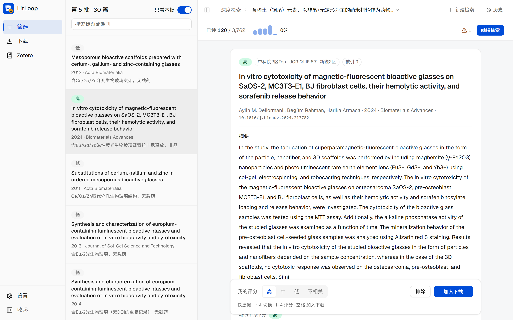
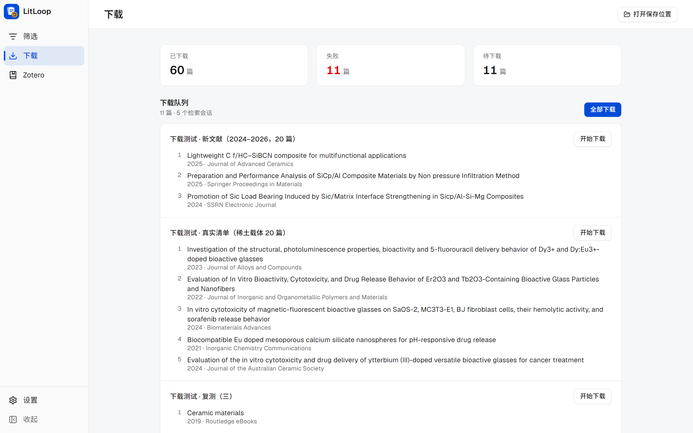
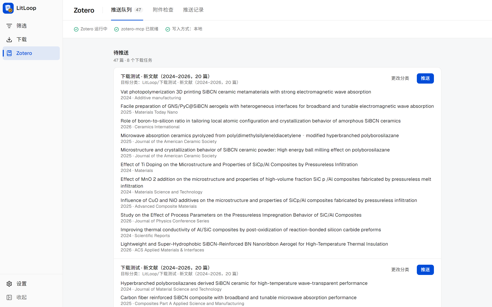
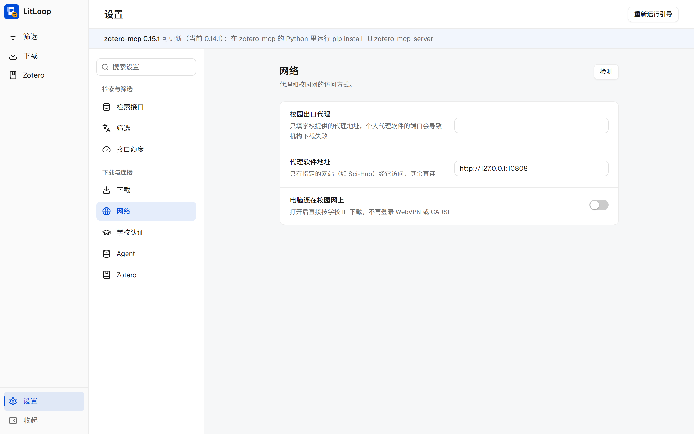

[English](README.md) · [简体中文](README.zh-CN.md)

<div align="center">
  
  <h1>LitLoop</h1>
  <p><strong>A desktop app for finding, screening, downloading and filing papers</strong> · an agent searches and scores in the background, you make the calls in the app</p>

  <a href="./LICENSE"></a>
  <a href="https://modelcontextprotocol.io"></a>
  
  

  [Screenshots](#screenshots) · [Why](#why-litloop) · [One full run](#one-full-run) · [The four screens](#the-four-screens) · [Deep search](#deep-search-how-it-gets-the-whole-topic) · [Downloading](#downloading-how-it-gets-the-pdf) · [Install](#install-and-run) · [Using it with an agent](#using-it-with-an-agent) · [Status](#project-status)
</div>

> **Still in development.** Search → screening → download → Zotero works end to end and has been checked against real topics and a small test set. The desktop app covers screening, downloads, Zotero, settings, the built-in agent and watched searches, and you can build your own installer. Systematic-review support stops at flow counts and export; analysis and synthesis are not built yet. See [Project status](#project-status).
>
> LitLoop is an independent derivative of [Rimagination/scansci-pdf](https://github.com/Rimagination/scansci-pdf) (Apache-2.0), maintained by [dysprosium231](https://github.com/dysprosium231); it is not affiliated with the original author. Most of the download and institutional-access machinery comes from that project; LitLoop's changes are listed in [NOTICE](NOTICE).

## Screenshots

| Screening: the agent's score and reason, your call | Downloads: the queue, one paper at a time |
|:---:|:---:|
|  |  |
| **Zotero: push a download batch into a collection** | **Settings: every group has a test button** |
|  |  |

## Why LitLoop

Literature work on a new topic usually gets stuck in four places. LitLoop handles each of them:

| Where it sticks | What LitLoop does |
|---|---|
| **Results are noisy** — half of the first pages are off-topic | Deduplicates, drops off-topic titles and junk records, folds preprints into the published version; every hit carries a cleaned abstract, the real citation count, and retraction or expression-of-concern flags |
| **Too much to read** — hundreds of abstracts, no idea where to start | An agent reads the abstracts and scores each paper high / medium / low / irrelevant with one sentence of reasoning; deep search keeps re-ranking from your scores so the likeliest papers come first |
| **Downloading is a chore** — open access, publisher site, campus WebVPN, CARSI, one after another | One click: open access first, then the publisher's own site, then each campus route in turn; when you need to log in or solve a captcha the app tells you and waits |
| **Filing is tedious** — dragging papers into Zotero and renaming files | Files are named `author-year_title-words_DOI.pdf`, pushed into a Zotero collection by download batch, reused when the item already exists, and checked for empty attachments |

A few rules it follows:

- **You decide.** The agent only scores and explains; which paper to keep and which to download is your call, and your score overrides the agent's.
- **Logins happen in your own browser.** Campus account, password and captcha are all yours to handle. LitLoop stores no passwords and does not bypass verification.
- **Data stays on your machine.** Screening records, download history and PDFs live in `~/.litloop/` and the folder you pick; Zotero writes go through the local interface.
- **API quota is visible.** Official limits are collected in [docs/API_LIMITS.md](docs/API_LIMITS.md), and the settings screen shows today's usage.

## One full run

Take "rare-earth-doped amorphous nanomaterials as drug carriers" as an example:

1. **Ask the question.** In the app's Screening screen, click "New search" and fill in the question and inclusion criteria — or just tell an agent (Claude Code, Codex, etc.): "find as much of the literature on rare-earth-doped amorphous nanocarriers for drug delivery as you can, and hand it to me in batches". If you would rather not keep a chat open, fill in a tool-calling model under Settings → Built-in agent and the app runs the search itself.
2. **The agent searches and scores.** Quick search answers in seconds; deep search first builds a candidate pool (a few thousand papers) and then hands you 30 at a time, already scored.
3. **You screen in the app.** The batch list is on the left, the abstract (translatable to Chinese), journal quartile, citation count and the agent's reason on the right. `↑`/`↓` moves, `1`–`4` scores, `space` adds to downloads. Click "Continue search" for the next batch without going back to the chat.
4. **Download.** The Downloads screen collects everything you picked across searches that has not been downloaded yet; click "Download all". Each paper shows what it is doing and where it finally came from; when it needs your campus login or a captcha, an amber banner appears at the top.
5. **Into Zotero.** The Zotero screen lists downloaded papers by batch; pick a collection and push.
6. **Look back.** "History" in the top right groups every search by topic, with how many papers were read and which ones you kept. Each topic shows the review flow (identified, deduplicated, included, excluded) and can export it as Markdown; the final list exports as BibTeX / RIS / a DOI list. Add a search to "Watched" and the app checks for new papers each time it opens.

## The four screens

### Screening

- **Batch list**: title, journal, year, the agent's score and one sentence of reasoning; filter to this batch, or search titles and journals.
- **Details**: full abstract, journal quartile (CAS and JCR, needs the companion plugin), citation count, DOI; the abstract can be translated automatically.
- **Translation**: under Settings → Screening choose the scope (high only, high and medium, everything, or off) and the service. DeepSeek and DeepL use your own key and translate when a paper is opened, without spending chat quota; choosing "agent" translates along with scoring.
- **Continue search**: after the agent stops, build the next batch from all scores so far; you score it first and the agent fills in its own scores once you return to the chat.
- **Deep-search progress**: papers scored / pool size, a small bar chart of the high-relevance share per batch, stage progress and an estimate of the time left; when it looks like a good place to stop, it says so.
- **History**: grouped by topic, how many papers each search read and which ones you kept. Expanding a topic shows one line of review flow — identified, after deduplication, screened, included, excluded, low-relevance undecided — exportable as Markdown for the methods section. The list can be exported or added to downloads in one click, and the search's query can be added to "Watched".
- **Watched**: saves a query; each time the app opens it checks (default every 7 days, configurable) and sends a system notification when there is something new, with a per-topic count of new papers.
- **Glossary**: several spellings of the same thing (e.g. `PDC = polymer-derived ceramic`) are searched together, and every search reports what it expanded. Deep search suggests abbreviations that recur in the abstracts it has read, and nothing takes effect until you confirm it. British/American spellings (aluminium / aluminum) and element symbols versus names (Al / aluminum) are built in; a bad expansion can be switched off individually.

### Downloads

- **Queue**: collected across searches, deduplicated and numbered; start one search's papers or all of them.
- **Per-paper state**: what it is doing right now (e.g. "opening Elsevier", "campus route: WebVPN browser"), the final source and file; failures say why and what to do next (e.g. "the institution does not subscribe: logged in through the institution and there is still no full text").
- **When it needs you**: campus login or captcha puts an amber banner at the top and the program waits; skip that one paper, or cancel the whole task.
- **Results**: open the PDF, open its folder, retry what failed.

### Zotero

- Shows whether Zotero and zotero-mcp are ready and how writing is done; if it is not local writing, authorise in one click (local writing takes a few seconds per paper).
- **Push queue**: downloaded papers not yet in Zotero, grouped by download batch; pick a collection and push — a missing collection is created.
- **Attachment check**: finds missing or empty PDF attachments in a collection, then re-attaches them from the local PDF or adds the papers to downloads.
- **Push history**: per-paper results (created, already in the library, PDF not attached, failed).

### Settings

- Search API keys, screening and translation, API quota, downloads, network, campus login, agent, Zotero — every group has a "Test" button.
- **Built-in agent**: works without any agent command installed. Fill in an Anthropic or OpenAI-compatible endpoint (DeepSeek, Qwen, Kimi, GLM, OpenRouter, Ollama, vLLM …) with its key and model name; "Test" checks on the spot that the model actually issues tool calls — a model that does not cannot run tasks. Set "Which backend" to "Built-in agent" and searches started in the app run on it.
- **Optional components**: layout analysis (about 65 MB, only affects how PDFs are converted to Markdown) is not installed by default; click "Install" in the same group when needed, and set a mirror if the download is slow.
- **API quota**: today's usage and the official limit for each API.
- **Network**: detects whether v2rayN, Clash and friends are in TUN mode and shows how to set direct rules; "this computer is on campus" makes downloads go straight out through the campus IP.
- **First-run guide**: on first launch it walks through search APIs, translation, downloads, network, campus login and Zotero; every step can be tested or skipped, and it can be re-run from settings later.
- Light and dark themes follow the system; the sidebar collapses to icons.

## Deep search: how it gets the whole topic

Deep search is for covering a topic properly. The agent produces the question, 4–8 English query variants, core terms and a few seed papers; if you already have a Zotero collection for the topic, the whole collection can serve as seeds.

1. **Build the pool**: take 100 hits per query variant, plus papers that share many references with the seeds and mention a core term in title or abstract. Several core terms can be required and all of them must appear; different spellings of one concept are joined with `|`, e.g. `Al|aluminum|aluminium`.
2. **Batch screening**: 30 papers per batch. The first batch is ranked by co-citation plus query match; afterwards a lightweight model re-ranks by all of your and the agent's scores (continuous active learning, as used in systematic-review screening).
3. **Snowballing**: papers scored "high" become new seeds and expand outwards; your own seeds carry the highest weight so the drift does not run away.
4. **Abstracts**: candidates without one are looked up in Semantic Scholar, Scopus and Crossref simultaneously, first answer wins, so a paper is not buried just because it arrived without an abstract.
5. **Suggesting a stop**: when the high-relevance share of the last batch falls below 1/6 of the best batch, or 200 papers have been screened, it suggests stopping and estimates how many relevant papers are still unread.

**Self-test results** (test sets and criteria in `tests/acceptance/`, replayable with `scripts/eval_deep_search.py`). There are only three test sets, 9–26 target papers each, drawn from the author's own Zotero collections and one review, with scores from the agent: they say something about these topics, not about the general case.

| Test set | Papers read | Targets found |
|---|---|---|
| SiC/Al pressureless infiltration | 150 | 17 of 19 |
| PDC ceramic aerogels | 120 | 24 of 26 |
| Rare-earth drug carriers | 150 | 2 of 9 (many branches, little cross-citation; still being improved) |

Parameters and quota control are documented in [docs/AGENT.md](docs/AGENT.md#检索与筛选).

## Downloading: how it gets the PDF

After "Download all", a list of up to 30 papers goes through these steps in order (longer lists go through the batch lanes):

```
1  Open access     direct OA links, DOI-built URLs for MDPI / SciOpen and similar, several at once
2  Sci-Hub         only when you turn it on; papers from 2024 on are skipped (barely indexed);
                   when the route is "fastest wins" it first measures speed
3  One by one      free sources and the publisher site in parallel -> then each campus route
                   campus routes: WebVPN direct download -> WebVPN browser -> CARSI -> EZProxy
```

- **Publisher sites**: about 30 publishers get dedicated handling (Elsevier, Wiley, Springer, ACS, RSC, T&F, SAGE, IOP, IEEE …), the rest go through a generic browser. If the campus IP already has access, this step alone gets the PDF.
- **Campus routes**: WebVPN at 100+ universities, CARSI federation login, EZProxy. Only one window opens at a time and waits for you; each step gets at most 4 minutes (extended while you are actually logging in) and then hands over to the next.
- **No wasted work**: if a publisher site still shows nothing after logging in through the institution, it is recorded as "not subscribed" and the campus routes are skipped; when Sci-Hub says it does not have a paper, it is not asked again for an hour.
- **Files**: named `author-year_first-title-words_DOI.pdf`, one file per paper; before accepting a PDF it checks that the paper is the right one. When only a preprint is available it first waits for the published version from the publisher and campus routes, and only then keeps the preprint, with `_preprint` in the file name and a note in the download record.
- **Logs**: every stage records its duration (`[timing]`), so a slow step is easy to find.

Measured on 2026-10-18 with a list of 14 new papers from 2024–2026, off campus, through WebVPN/CARSI: 11 succeeded. Publisher sites for Elsevier, T&F and ACS generally take 20–70 seconds per paper, open access 10–25 seconds. Of the three failures, one was a conference chapter the institution does not subscribe to and one was an SSRN preprint.

Publisher and institutional configuration, proxy setup and troubleshooting are in [docs/DOWNLOAD.md](docs/DOWNLOAD.md). Sci-Hub and LibGen are off by default; whether to use them is your decision. When using institutional routes, respect your university's and the publishers' terms.

## Install and run

You can run the app from source, or build your own installer. Running from source needs Python 3.11+, Git, Node.js and Rust (the MSVC toolchain on Windows).

1. **Install the Python side.** The easiest way is to tell an agent in Claude Code, Codex or ZCode:

   ```text
   Install or update this plugin for me: https://github.com/dysprosium231/litloop-paper-agent
   ```

   The agent pulls the code, creates a dedicated virtual environment, installs dependencies and registers the MCP server. Manual steps are in [docs/AGENT.md](docs/AGENT.md#安装与配置详情).

2. **Start the app.** In the repository's `app` directory:

   ```bash
   npm install
   npm run tauri dev
   ```

   The first Rust build takes a few minutes, later ones about half a minute before a window appears. The `LITLOOP_PYTHON` environment variable can point at a Python that has LitLoop installed. Development notes and restart scripts are in [app/README.md](app/README.md).

3. **Walk through the first-run guide.** At minimum fill in an OpenAlex key and a contact email; to download subscription papers, pick your university under "Campus login". Nothing has to be filled in to try it: with an empty config a quick search falls back to Crossref — a five-result query took five seconds when measured on 2026-11-05.

### Building an installer

```bash
python scripts/build_release.py --bundle
```

It first stages an embedded Python runtime in `build/runtime` (the official embeddable distribution, the core dependencies and `uv.exe`), then calls `npm run tauri build`. The result is `app/src-tauri/target/release/bundle/nsis/LitLoop_<version>_x64-setup.exe`, about 110 MiB, with Python and the dependencies inside — the target machine needs nothing installed.

- Installing needs administrator rights (`installMode: both`).
- The installer is **unsigned**: Windows shows the SmartScreen "unrecognised app" prompt, where you click "More info → Run anyway"; some company machines block this by policy.
- Layout analysis (about 65 MB, only affects how PDFs are converted to Markdown) is not included; install it on demand under Settings → Optional components, with a mirror if the download is slow.

### Dependencies and keys

| Component | Needed? | What it does | Without it | How to get it |
|---|---|---|---|---|
| Python 3.11+, Git | Required | Running and updating LitLoop | Does not run | Windows: `winget install Python.Python.3.12 Git.Git` |
| OpenAlex API key | **Strongly recommended** | The main data source for quick and deep search | About 1000 credits a day, which one deep search can use up | Free at [openalex.org](https://openalex.org); put it in settings or `OPENALEX_API_KEY` |
| Elsevier API key | **Strongly recommended** | Abstracts from Scopus; ScienceDirect full text where you have access | Elsevier papers often lack abstracts and deep search can only rank by title | Free at [dev.elsevier.com](https://dev.elsevier.com); `ELSEVIER_API_KEY` |
| Springer Nature Meta API key | Recommended | Abstracts for Springer, Nature and BMC papers | Only Scopus and Crossref, so more misses | [dev.springernature.com](https://dev.springernature.com); `SPRINGER_META_API_KEY` |
| Contact email | Recommended | Sent to Crossref, OpenAlex and Unpaywall for contact and higher limits | Crossref rate-limits you in the public pool | Set it in the app |
| scansci-find (discovery engine) | Recommended | The keyword route for quick and deep search | Falls back to the built-in search, slower | Install with `--with-find` |
| Zotero 7+, zotero-mcp | Optional | Writes papers and PDFs into your local Zotero | Downloads only, no library updates | Authorise local writing on the Zotero screen |
| Local Chrome | Optional | Publisher pages and campus logins | Browser-dependent routes are unavailable; open access still works | Any normal Chrome; LitLoop makes its own isolated copy |
| Campus account | Optional | Subscription papers through WebVPN / CARSI / EZProxy | Only open-access and public versions | See [docs/DOWNLOAD.md](docs/DOWNLOAD.md) |
| Semantic Scholar API key | Optional | One more search source, faster abstract lookups | Core features are unaffected | [semanticscholar.org/product/api](https://www.semanticscholar.org/product/api); `SEMANTIC_SCHOLAR_API_KEY` |
| litloop-journal-rank | Optional (not public) | Journal quartiles, warning lists, local retraction data | No quartile information; retraction flags come from OpenAlex | Not released yet |

Every configuration key is in [docs/CONFIG.md](docs/CONFIG.md).

## Using it with an agent

LitLoop is also an MCP server (21 tools) and a command-line tool. Installed into Claude Code, Codex or ZCode, the whole flow can be one sentence, without opening the app:

```text
Find papers from the last five years on urban heat islands and green-space cooling, CAS zone 2 or better, no retractions
Screen these 30 by relevance to my topic, explain each choice, I will pick
Use these 3 as seeds and cover SiC/Al pressureless infiltration as fully as you can, hand it to me in batches
Download the ones I picked and push them into my Zotero "heat island" collection
This list has 3000 papers; split it into ones I can fetch directly and ones that need campus access, then download in batches
This download failed, help me diagnose it
```

The app and the agent share one store: scores the agent saved show up in the app, and changes you make in the app are visible to the agent (format in [docs/APP_DATA.md](docs/APP_DATA.md)).

Command line:

```bash
litloop search "urban heat island" --year-from 2021 --sort cited   # search
litloop search "carbon cycle" --out q.txt                         # write hits to a download queue
litloop get 10.1038/nature12373                                   # download one paper
litloop batch q.txt --lanes                                       # batch download (xlsx/csv/bib/queue files)
litloop check                                                     # check dependencies and environment
```

The full MCP tool list, manual MCP configuration (Claude Desktop, Cursor, Cline …) and search filters are in [docs/AGENT.md](docs/AGENT.md).

## More documentation

| Document | Contents |
|---|---|
| [docs/AGENT.md](docs/AGENT.md) | Install details, the full MCP tool list, search filters, deep-search parameters |
| [docs/DOWNLOAD.md](docs/DOWNLOAD.md) | Download layers, Elsevier API, WebVPN, CARSI, EZProxy, proxies, troubleshooting |
| [docs/CONFIG.md](docs/CONFIG.md) | Every configuration key and its default |
| [docs/API_LIMITS.md](docs/API_LIMITS.md) | Official limits of each external API (with sources and check dates) and LitLoop's pacing |
| [docs/APP_DATA.md](docs/APP_DATA.md) | File formats the app and the agent share |
| [app/README.md](app/README.md) | Developing the desktop app |
| [AGENTS.md](AGENTS.md) · [docs/LAYOUT.md](docs/LAYOUT.md) | Contribution conventions · code layout (what each subpackage owns) |
| [CHARTER.md](CHARTER.md) · [TODO.md](TODO.md) · [docs/DECISIONS.md](docs/DECISIONS.md) | Design and acceptance criteria · progress and to-dos · decisions and experiment logs |

## Project status

October 2026: in development, used by the maintainer, feedback welcome. Every change runs the full test suite on Linux, Windows and macOS across Python 3.11–3.13.

### Working today

Run end to end on a real topic (precursor-derived SiBCN ceramics for insulation and microwave absorption) — search → screening → download → Zotero:

| Step | State |
|---|---|
| Search | OpenAlex (Crossref when there is no key, Semantic Scholar when a key is set); searches glossary variants — abbreviations, full names, British/American spellings, element symbols — at once; filters off-topic and junk records; folds preprints into the published version; completes and cleans abstracts; flags retractions and expressions of concern; sorts by citations or date |
| Screening | The AI scores each paper and explains why, you choose, records stay local and become a download queue |
| Deep search | Multiple query variants plus co-citation build the pool, batch screening, re-ranking from your scores, high-relevance papers snowball |
| Download | Open access, publisher sites, campus routes in turn; WebVPN, CARSI, EZProxy; DOI in the file name, one paper per file; preprints are marked `_preprint` |
| Zotero | Local writing, a few seconds per paper; checks for empty attachments |
| Desktop app | Screening, downloads, Zotero, settings and quota, built-in agent and watched searches all work; you can build the installer (about 110 MiB, Python runtime included); auto-update and code signing are still missing |

### Known limits

- A quick search takes about 6–10 seconds and returns only the first 10–20 hits per query variant; use deep search to cover a topic.
- Deep search takes about a minute per batch (pool expansion plus abstracts).
- Topics with many branches and little cross-citation (rare-earth drug carriers, for instance) are still not covered fully.
- Journal quartiles and the local retraction database need the companion plugin litloop-journal-rank, which is not public yet.
- Chinese-language databases (CNKI, Wanfang) are not supported yet.

### Still to build

In planned order; progress is tracked in [TODO.md](TODO.md).

1. **Desktop app**: the installer can be built; auto-update and signing remain. The built-in agent (the app calling Anthropic / OpenAI-compatible APIs itself) can already run searches started in the app; per-task model choice and a test-set comparison against an external agent are still open.
2. **Systematic-review support**: flow counts (identified, deduplicated, included, excluded, with reasons) and Markdown export are done; resuming an interrupted review is not.
3. **Watched searches**: saving a query, checking when the app opens, notifying, and listing the new papers with a one-click "add to downloads" are done; feeding those papers straight into a screening session is not.
4. **Analysis and synthesis**: PDF to Markdown exists; extracting findings from full text, building comparison tables and drafting a review are next.
5. **Chinese literature**: CNKI and Wanfang.
6. **Publishing the quartile plugin**: the data is licensed, so it must be opened up to user-supplied data first.

## Credits

LitLoop is built on **[scansci-pdf](https://github.com/Rimagination/scansci-pdf)** by [Rimagination](https://github.com/Rimagination) (Apache-2.0). The original project drew on [FlareSolverr](https://github.com/FlareSolverr/FlareSolverr), [ref-downloader](https://github.com/ltczding-gif/ref-downloader), [paper-fetch-skill](https://github.com/Dictation354/paper-fetch-skill), [paper-fetcher](https://github.com/fermionoid/paper-fetcher) and [cloakbrowser](https://github.com/CloakHQ/CloakBrowser).

The original project's contributor [annsyun](https://github.com/annsyun) implemented the institutional download route for SAGE China ([Rimagination/scansci-pdf#58](https://github.com/Rimagination/scansci-pdf/pull/58)).

Search uses public data from [OpenAlex](https://openalex.org), [Semantic Scholar](https://www.semanticscholar.org) and [Crossref](https://www.crossref.org). Retraction data comes from [Retraction Watch](https://retractionwatch.com), published by Crossref.

## License

[Apache License 2.0](LICENSE). The original project's copyright notices are kept in LICENSE and [NOTICE](NOTICE). The prebuilt extensions the original project shipped through PyPI (`_core/*.pyd`, `*.so`) are not in this repository; LitLoop uses pure Python.
